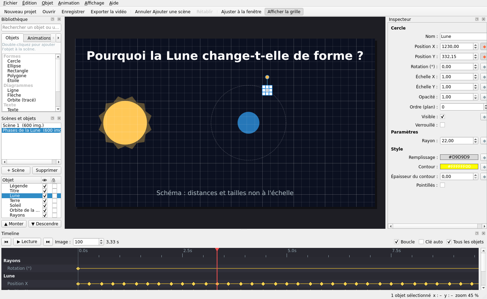

# ANTARES Studio

**Scientific Animation & Storytelling Studio** — logiciel de bureau de création de vidéos scientifiques 2D/3D, visuel, local et extensible, conçu notamment pour la vulgarisation de l'astronomie, de l'astrophysique, des mathématiques et de la physique en français auprès d'un public africain francophone.

> **État :** le cœur sans interface (modèle, timeline, persistance, export MP4) est implémenté et testé ; l'interface graphique est en cours (voir `docs/PROJECT_STATUS.md`). La présence de documents ne signifie PAS qu'une fonctionnalité est utilisable tant qu'elle n'est pas listée comme telle.

## Point d'entrée pour l'agent

1. Lire [`AGENTS.md`](AGENTS.md) en entier.
2. Lire [`docs/ANTARES_MASTER_PROMPT.md`](docs/ANTARES_MASTER_PROMPT.md), référentiel produit et plan de développement.
3. Lire [`docs/TEST_STRATEGY.md`](docs/TEST_STRATEGY.md) et [`docs/RESEARCH_PROTOCOL.md`](docs/RESEARCH_PROTOCOL.md).
4. Lire et mettre à jour [`docs/PROJECT_STATUS.md`](docs/PROJECT_STATUS.md) à chaque session.
5. **Démarrer la Phase 0**, produire les preuves de faisabilité, puis poursuivre de façon autonome dans les limites indiquées dans `AGENTS.md`.

## Principes du produit

- Création sans code pour les usages courants ; contrôle Python avancé optionnel.
- Prévisualisation interactive fluide, timeline réversible, sauvegarde portable et rendu déterministe.
- Windows 11 prioritaire, Linux à terme, fonctionnement hors ligne, sans abonnement obligatoire.
- Un format de projet indépendant des moteurs ; intégrations Manim Community/ManimGL/Blender **à qualifier et isoler**, pas de mélange implicite d'API.
- Ressources visuelles, audio et scientifiques sous licences documentées ; pas de téléchargement silencieux.
- Priorité au **premier parcours utilisable de bout en bout**, plutôt qu'à l'accumulation de fonctionnalités inachevées.

## Dépôt

Dépôt officiel : https://github.com/Wendsore/ANTARES-STUDIO

## Installation développeur (Linux / Windows)

Prérequis : Python 3.12 ou 3.13, FFmpeg (avec `ffprobe`) dans le `PATH` ou indiqué par la variable `ANTARES_FFMPEG`.

```bash
uv venv .venv --python 3.13          # ou : python -m venv .venv
uv pip install --python .venv/bin/python -e '.[dev]'
.venv/bin/python -m ruff check . && .venv/bin/python -m mypy src
QT_QPA_PLATFORM=offscreen .venv/bin/python -m pytest -q
```

Sous Windows : `.venv\Scripts\python -m pip install -e .[dev]` puis `.venv\Scripts\python -m pytest -q`.

Les tests marqués `render` exigent FFmpeg et sont ignorés (visibles comme `skipped`) s'il est absent.

Paquet Windows (phase 9, en cours) : `pip install pyinstaller==6.22.3` puis `python packaging/build.py --check` ; la CI publie l'archive `ANTARES-Studio-windows-x64.zip`. Contrôle d'installation : `"ANTARES Studio.exe" --selftest`.

## État d'avancement

Voir [`docs/PROJECT_STATUS.md`](docs/PROJECT_STATUS.md) (vérité sur les phases), [`CHANGELOG.md`](CHANGELOG.md), les ADR dans [`docs/adr/`](docs/adr/) et le guide [`docs/user-guide/01-premiere-video.md`](docs/user-guide/01-premiere-video.md).

Dans le logiciel : **Aide > Centre d'aide** (F1, 32 rubriques en français, recherche, aide contextuelle), **Aide > Tutoriels** (7 parcours guidés validés automatiquement sur vos actions), **Ctrl+K** pour retrouver n'importe quelle commande, thème sombre ou clair et taille du texte dans **Affichage**.

## Lancer l'application

```bash
.venv/bin/antares-studio                 # Linux
.venv\\Scripts\\antares-studio.exe        # Windows
```



## Licence

**À décider explicitement avant publication de code sous licence.** Ne pas présumer que ce dépôt ou ses futurs contenus sont déjà sous une licence open source déterminée. La distribution des binaires et des composants tiers devra faire l'objet d'un inventaire et d'une revue de conformité.