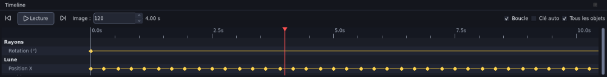

# Images clés et Timeline

Une **image clé** fixe la valeur d'une propriété (position, rotation, opacité, couleur, rayon…) à un instant donné. Entre deux clés, ANTARES calcule les valeurs intermédiaires.

## La Timeline

- **Règle graduée** en secondes, en haut. Cliquez ou glissez pour déplacer la **tête de lecture** rouge.
- Une **piste** par objet, puis une ligne par propriété animée, avec ses **losanges** jaunes (clés).
- Une piste **Sous-titres** et une piste **♪** par clip audio, avec sa forme d'onde.
- La zone grisée à droite est au-delà de la fin de la scène.

### Commandes

| Élément | Rôle |
|---|---|
| ⏮ / ⏭ | début / fin de la scène |
| **Lecture** / **Pause** | lecture en temps réel (Espace) |
| *Image* | numéro de l'image courante, réglable au clavier ; la durée en secondes est affichée à côté |
| *Boucle* | la lecture recommence au début |
| *Clé auto* | toute modification pose une clé à l'image courante |
| *Tous les objets* | décoché : seules les pistes des objets sélectionnés sont montrées |

### Gestes

| Geste | Effet |
|---|---|
| Molette | défiler dans le temps |
| Ctrl + molette | zoom temporel |
| Glisser un losange | déplace la clé dans le temps |
| Clic sur un losange, puis Suppr | supprime la clé |
| Glisser un clip audio | décale la narration |
| ← / → (Timeline active) | image précédente / suivante |
| , et . (partout) | image précédente / suivante |
| Début / Fin | début / fin de la scène |

## Poser des clés

1. Placez la tête de lecture.
2. Dans l'[Inspecteur](inspecteur.md), cliquez sur le **losange ◆** de la propriété : une clé est posée avec la valeur actuelle.
3. Déplacez la tête de lecture, changez la valeur : une nouvelle clé est posée.

Dès qu'une propriété est animée, **toute modification** de cette propriété, sur le canevas ou dans l'Inspecteur, pose ou met à jour la clé de l'image courante. Avec **Clé auto**, c'est vrai aussi des propriétés pas encore animées.

Pour retirer toute l'animation d'une propriété : **clic droit** sur son losange dans l'Inspecteur.

## Interpolation des clés

Les clés posées à la main sont **linéaires**. Les [animations prédéfinies](animations.md) proposent accélération et décélération. Le choix de l'interpolation clé par clé n'est pas encore disponible dans l'interface.

## Lecture

La lecture de l'éditeur vise le temps réel ; sur une machine lente, des images peuvent être sautées pendant l'aperçu. L'export, lui, calcule **toutes** les images.
