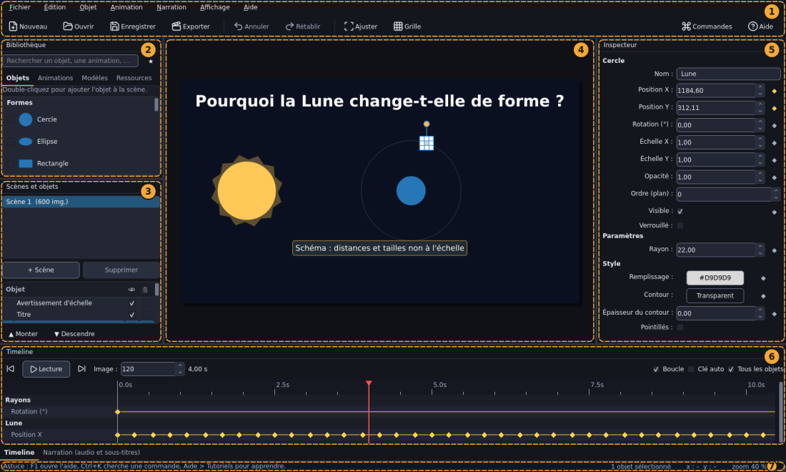

# L'espace de travail

1. **Barre de menus et barre d'outils** — en haut. Les boutons les plus utiles : Nouveau, Ouvrir, Enregistrer, Exporter, Annuler, Rétablir, Ajuster la vue, Grille, Aide.
2. **Bibliothèque** — à gauche, en haut. Onglets *Objets*, *Animations*, *Modèles* et *Ressources*, champ de recherche et filtre ★ des favoris. Voir [La Bibliothèque](bibliotheque.md).
3. **Scènes et objets** — à gauche, en bas. Liste des scènes du projet, puis arbre des objets de la scène courante avec visibilité (œil) et verrou (cadenas). Voir [Scènes, calques et groupes](scenes-et-calques.md).
4. **Canevas** — au centre. L'image de la scène, identique à la vidéo exportée. Voir [Le canevas](canevas.md).
5. **Inspecteur** — à droite. Les propriétés de l'objet sélectionné, ou de la scène et du projet si rien n'est sélectionné. Voir [L'Inspecteur](inspecteur.md).
6. **Timeline** et **Narration** — en bas, sur deux onglets. Temps, images clés, pistes audio et sous-titres. Voir [Images clés et Timeline](images-cles.md) et [Narration](narration.md).
7. **Barre d'état** — tout en bas : messages, position du pointeur dans la scène (en pixels de la vidéo) et zoom.

Le panneau **Tutoriel** s'ouvre à droite quand vous lancez un [tutoriel](tutoriels.md).

## Déplacer et retrouver les panneaux

- Chaque panneau se détache en tirant sa barre de titre et se redimensionne en tirant son bord.
- **Affichage** permet d'afficher ou masquer chaque panneau.
- **Affichage > Réinitialiser la disposition** remet tout à sa place d'origine.
- La disposition est retenue d'une session à l'autre.

## Changer l'apparence

Thème sombre ou clair, taille du texte : voir [Thème, taille du texte et disposition](personnalisation.md).
